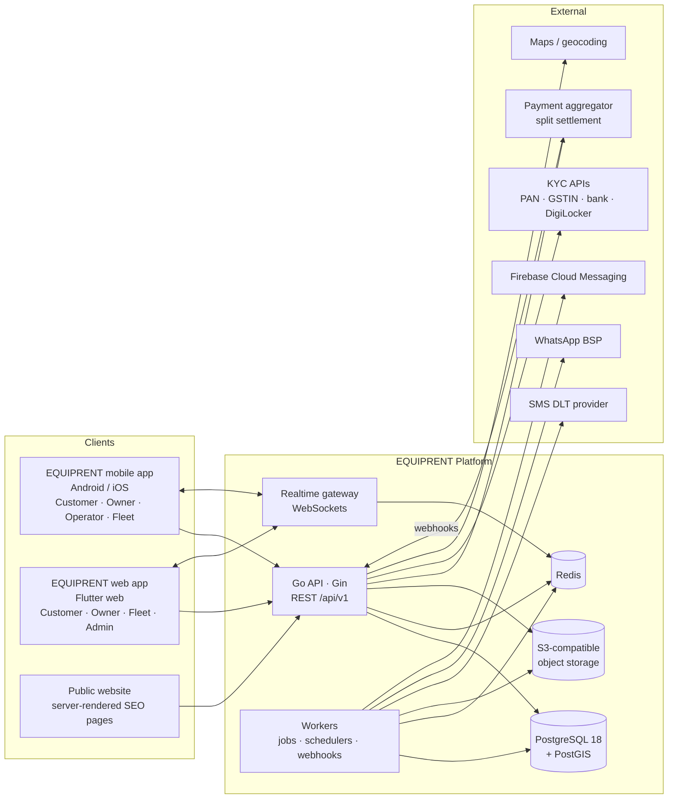
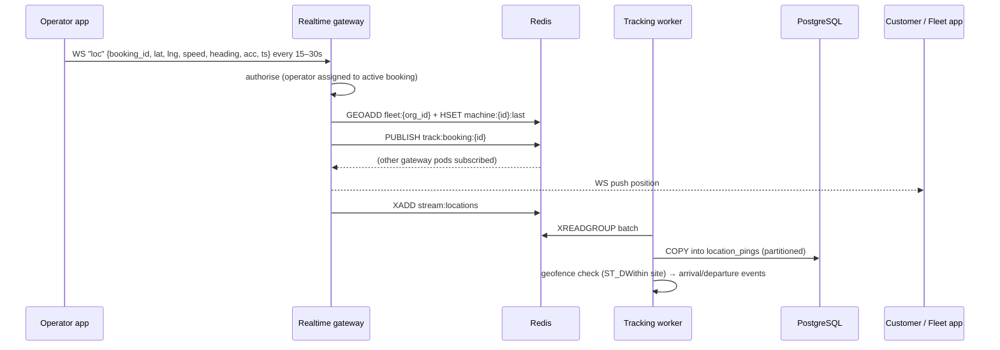

# EQUIPRENT — Architecture

Status: Draft v0.1 (proposal for approval) · 2026-11-12

## 1. Architectural principles

1. **Modular monolith first.** One Go binary with strict internal module boundaries. Split into services only when a module has a different scaling or deployment need. The real-time tracking gateway is the first candidate.
2. **PostgreSQL is the source of truth.** Redis is only for cache, ephemeral state, rate limiting, pub/sub and job queues. Losing Redis must not lose business data.
3. **Money and bookings are state machines.** Transitions are explicit, validated in one place, and recorded in history tables.
4. **Type-safe SQL.** sqlc generates Go code from hand-written SQL. No ORM. pgx is the driver and pool.
5. **Offline-tolerant clients.** The mobile app queues writes with client-generated IDs and idempotency keys.
6. **India-first.** India hosting region, INR in paise (integer), IST display, UTC storage.
7. **Twelve-factor.** Config from environment, stateless API pods, Docker images everywhere.

## 2. System context



## 3. Technology stack

| Layer | Choice | Why |
|---|---|---|
| Mobile + web client | **Flutter** (stable 3.44 / Dart 3.12 installed) | One codebase for Android, iOS and web dashboards |
| State management | **Riverpod** (with code generation, `riverpod_generator`) | Testable, compile-safe DI + state |
| Routing | **GoRouter** | Declarative, deep links, URL-based routing for web, redirect guards by role |
| HTTP | **Dio** + interceptors (auth refresh, idempotency key, retry with backoff, logging) | Mature, interceptor model |
| Models | `freezed` + `json_serializable` | Immutable models, unions for states |
| Local storage | `drift` (SQLite) for offline queue + cache. `flutter_secure_storage` for tokens | Offline-first operator workflow |
| Maps (client) | `google_maps_flutter`, or MapLibre with Indian tiles (Ola/Mappls) | Decided by maps provider choice |
| Location | `geolocator` + Android foreground service | Background tracking during active jobs only |
| Push | `firebase_messaging` | FCM for Android + iOS |
| i18n | `flutter_localizations` + ARB files | English + Hindi at MVP |
| Backend language | **Go 1.26** | Simple, fast, great concurrency for WebSockets |
| HTTP framework | **Gin** | Requested. Middleware ecosystem |
| DB driver | **pgx v5** (`pgxpool`) | Fastest Postgres driver, native types, COPY, LISTEN/NOTIFY |
| SQL codegen | **sqlc** | Type-safe queries from SQL |
| Migrations | **golang-migrate** (plain up/down SQL files in `backend/migrations`) | Chosen at project init. sqlc reads the same files |
| Database | **PostgreSQL 18 + PostGIS 3.6**, `btree_gist`, `pg_trgm` | Geo search, exclusion constraints against double booking, fuzzy search. PG18 has native `uuidv7()` |
| Cache / queue | **Redis 7+**, **asynq** for background jobs | Delayed jobs (booking expiry, payout schedules), retries, dashboard |
| WebSockets | `github.com/coder/websocket` behind Gin | Context-aware, maintained |
| Object storage | **S3 API**: MinIO locally. AWS S3 (Mumbai) or Cloudflare R2 in production | Presigned uploads directly from client |
| Auth | JWT (EdDSA) access tokens + opaque rotating refresh tokens in DB | Short-lived stateless access, revocable sessions |
| Validation | `go-playground/validator` (Gin default) | |
| Config | env vars via `caarlos0/env` | Twelve-factor |
| Logging | `log/slog` JSON | Standard library |
| Observability | OpenTelemetry → Grafana stack (Loki, Prometheus/Mimir, Tempo) or a hosted equivalent | |
| Containers | **Docker**, Docker Compose for local dev | |
| CI/CD | GitHub Actions (backend, Android, web). Codemagic for iOS builds | No macOS machine available locally |

## 4. Client architecture

### 4.1 App split (recommendation)

| Deliverable | Tech | Audience |
|---|---|---|
| **`equiprent_app`** (Android + iOS) | Flutter | Customer, Owner, Operator, Fleet Manager (lite). Role switch in profile. Each role gets its own shell (bottom-nav set) |
| **`equiprent_web`** | Flutter web | Customer web, Owner dashboard, Fleet Manager dashboard, Admin dashboard. Role-based route trees under `/app`, `/owner`, `/fleet`, `/admin` |
| **Public website** | Go `html/template` server-rendered pages served by the API binary (or a separate tiny service) | Landing, city/category SEO pages, listing previews, legal pages. Flutter web is poor for SEO and first-load on slow 3G |

**Why one mobile app:** owners are often also operators or customers. One store listing, one login, shared code. The background-location permission is requested **only** when someone enables Operator mode, which keeps app-store review simple.

**Admin on Flutter web** is acceptable because admins use desktop browsers on good connections. If the admin console gets very table-heavy later, a React admin can replace it without touching the API.

> Run Flutter web locally with `flutter run -d chrome --no-web-resources-cdn`. This machine loads CanvasKit slowly from the CDN.

### 4.2 Flutter monorepo layout (Dart pub workspaces)

```
apps/
  mobile/                 # equiprent_app (Android/iOS)
  web/                    # equiprent_web (dashboards)
packages/
  core/                   # env, logging, result types, formatters (₹, IST)
  api_client/             # Dio client, interceptors, DTOs, generated from OpenAPI
  domain/                 # entities, enums, booking state machine mirror
  design_system/          # theme, tokens, components (brand: Rent Smart. Build Better.)
  l10n/                   # ARB files en, hi
  features/
    auth/  catalog/  search/  booking/  payments/  tracking/
    owner_listings/  operator_jobs/  fleet/  admin/  notifications/  kyc/
```

Each feature package uses **presentation (widgets) → application (Riverpod notifiers) → data (repositories over api_client + drift)**.

### 4.3 Routing and role guards
- GoRouter `redirect` checks `authState` and `activeRole`. Unknown or unauthorised role routes go to `/forbidden`.
- `StatefulShellRoute` per role keeps tab state.
- Deep links: `equiprent://booking/{id}` and `https://equiprent.in/b/{id}` (App Links / Universal Links).

### 4.4 Offline strategy (operator flows)
- Writes such as checklist, HMR log, photos and breakdown report go to a **drift outbox table** with `client_id` (UUIDv7) and an `Idempotency-Key`.
- A sync worker drains the outbox when connectivity returns, uploading photos first via presigned URLs, then posting metadata.
- The server treats repeated keys as no-ops and returns the original response.
- Captured-at timestamps come from the device. The server also stores received-at and flags large skew.

## 5. Backend architecture

### 5.1 Repository layout (Go)

```
backend/
  cmd/
    api/            # HTTP API + public SSR pages
    worker/         # asynq workers + schedulers
    realtime/       # WebSocket gateway (same image, different entrypoint)
    (migrations run with the golang-migrate CLI / migrate image)
  internal/
    platform/       # config, db (pgxpool), redis, s3, logger, otel, httpx (errors, pagination)
    auth/           # otp, sessions, jwt, middleware
    identity/       # users, roles, organisations, members
    kyc/
    catalog/        # taxonomy, equipment, media, documents, pricing, availability
    search/
    booking/        # state machine, quotes, assignments, handover, hmr logs, extensions
    payment/        # gateway adapter, payments, refunds, deposits, webhooks
    ledger/         # double-entry ledger, commission, tax (GST/TCS/TDS)
    invoice/        # invoice numbering + PDF generation
    payout/
    tracking/       # location ingest, trips, geofences
    fleet/          # maintenance, utilisation
    review/
    dispute/
    notification/   # templates, push, sms, whatsapp, email, in-app
    admin/
    audit/
  db/
    migrations/     # golang-migrate SQL files (NNNNNN_name.up/down.sql)
    queries/        # sqlc .sql files, one per module
    sqlc.yaml
  api/openapi.yaml  # source of truth for API contract → Dart client generation
```

### 5.2 Module rules
- Each module exposes a **service interface** and owns its tables. Other modules call the service, never its queries.
- Cross-module side effects such as "booking completed → create invoice → schedule payout" go through a **transactional outbox**: write an event row in the same DB transaction, then a worker publishes it to asynq. This gives at-least-once delivery without dual-write bugs.
- Handlers are thin: parse → authorise → call service → map errors.

### 5.3 Request pipeline (Gin middleware order)
`RequestID → Recover → Structured logging → OTel tracing → CORS (web origins only) → Rate limit (Redis) → Auth (JWT) → Org/role context → Handler`

### 5.4 Background jobs (asynq)
| Job | Trigger |
|---|---|
| `booking.expire_request` | Delayed. Fires at owner response SLA |
| `booking.auto_approve_hmr` | Delayed 24h after HMR log submitted |
| `booking.start_reminder` | Scheduled before start |
| `payment.reconcile_daily` | Cron 02:00 IST |
| `payout.create_batch` | Cron daily. Eligible settlements past hold period |
| `document.expiry_scan` | Cron daily. Insurance/RC/licence expiry warnings and auto-unlisting |
| `notification.send` | Event-driven fan-out |
| `tracking.close_stale_trips` | Cron every 10 min |
| `media.process_image` | On upload. Thumbnails, EXIF stripping (keep GPS only in metadata table for checklist photos) |
| `outbox.dispatch` | Poll every 1s (or `LISTEN/NOTIFY`) |

## 6. Data architecture (summary)

Full design: [DATABASE_DESIGN.md](DATABASE_DESIGN.md).
- IDs: **UUIDv7** (time-ordered, index-friendly; native `uuidv7()` in PG18).
- Money: `BIGINT` paise + `currency CHAR(3) DEFAULT 'INR'`.
- Time: `timestamptz` in UTC. Rental periods as `tstzrange`.
- Geo: `geography(Point, 4326)` with GiST indexes.
- High-volume `location_pings` partitioned by month, with a 90-day retention default.
- Soft delete only where needed for legal retention (`deleted_at`). Most entities are status-driven.

## 7. Location and tracking architecture



- **Ingest frequency:** adaptive. 15s while moving above 5 km/h, 60s when stationary, 5s for the final 1 km of dispatch for ETA accuracy.
- **Fallback:** if WebSocket fails, the app batches points and POSTs `/tracking/batch` (offline catch-up).
- **Privacy:** tracking only between `DISPATCHED` and `RETURNED` states, plus explicit operator consent. A persistent notification shows while it runs.
- **ETA:** maps provider directions API, cached per booking and refreshed at most every 2 min.
- **Phase 3 telematics:** a device/OEM adapter writes into the same `location_pings` + `hmr_readings` with `source = 'telematics'`.

## 8. Real-time (WebSockets)

- Single endpoint `GET /ws` with an access token in the `Sec-WebSocket-Protocol` header (or a short-lived ticket from `POST /ws/ticket`), never in the query string.
- Topics clients may subscribe to: `booking:{id}`, `fleet:{org_id}`, `user:{id}` (notifications), `admin:ops`. Each subscription is authorised server-side.
- Fan-out across gateway pods via **Redis pub/sub**. Sticky sessions not required.
- Heartbeat ping every 25s. The client reconnects with exponential backoff + jitter.
- WebSockets are **only for live updates**. All state changes go through REST so they're validated, audited and idempotent.

## 9. Files and media

- Upload flow: client calls `POST /uploads` with `{purpose, content_type, size}`. The server returns a **presigned PUT URL** (5 min) + `upload_id`. The client uploads directly to S3, then references `upload_id` in the domain call. The worker validates MIME by sniffing magic bytes, scans, and generates thumbnails.
- Buckets: `equiprent-public` (listing photos via CDN) and `equiprent-private` (KYC, invoices, checklists), with private objects served by short-lived presigned GET URLs only.
- Invoice PDFs are generated server-side (Go PDF library) and stored immutably.

## 10. Deployment

### 10.1 Local development (Docker Compose)
`postgis/postgis:18-3.6` (or current 18.x PostGIS tag), `redis:7-alpine`, `minio/minio`, `mailpit` (email capture), plus the API/worker/realtime run natively with `air` hot reload or in containers.

### 10.2 Environments
| Env | Purpose | Infra |
|---|---|---|
| `local` | Developer machine | Docker Compose |
| `staging` | QA, PA sandbox, internal testing | Single VM or small container service, India region |
| `production` | Live | India region. See phases below |

### 10.3 Production phases
- **Phase A (pilot):** 1–2 VMs running Docker Compose / systemd behind Caddy or Nginx (TLS). **Managed PostgreSQL with PostGIS** (e.g. AWS RDS Mumbai). Managed or self-hosted Redis. S3/R2 + CDN. Nightly logical backups + PITR on managed DB.
- **Phase B (growth):** containers on ECS Fargate / a managed Kubernetes service. API, worker and realtime scale independently. Read replica for search and analytics.
- **Phase C (scale):** split tracking into its own service + time-series storage (TimescaleDB extension or a dedicated store). Search moves to OpenSearch if PostGIS + `pg_trgm` stop being enough. Event bus (NATS/Kafka) replaces the outbox→asynq bridge for high-volume events.

### 10.4 CI/CD
- **Backend:** lint (`golangci-lint`), `sqlc vet` / `sqlc diff`, unit tests, integration tests against ephemeral PostGIS (testcontainers), build image, push, deploy to staging, manual promote to prod.
- **Mobile:** `flutter analyze`, tests, build Android AAB (GitHub Actions) → Play internal track. iOS IPA via **Codemagic** → TestFlight.
- **Web:** Flutter web build → static hosting/CDN.
- Migrations run as a separate release step before rollout. They must be backward compatible (expand → migrate → contract).

## 11. Scalability path

| Load signal | Response |
|---|---|
| API CPU high | Horizontal API pods (stateless) |
| Search latency | Read replica, materialised "search_listings" view refreshed on change, Redis cache for hot category+city queries |
| Location write volume (≥ ~2k pings/s) | Batch COPY, partitioning, move to TimescaleDB hypertables or a separate tracking DB |
| WebSocket connections (≥ ~20k) | Dedicated realtime pods, tune Redis pub/sub or move to NATS |
| Multi-city growth | City as first-class dimension (pricing, commission, ops teams). Data stays single-region India |
| Reporting load | Nightly ETL to an analytics warehouse (e.g. ClickHouse/BigQuery-in-India region) |

## 12. Architecture decisions to approve

| ADR | Decision | Alternatives considered |
|---|---|---|
| 001 | Modular monolith in Go | Microservices (too early, too costly) |
| 002 | One mobile app with role switching | Separate customer and partner apps |
| 003 | Flutter web for dashboards + Go SSR for public SEO pages | Flutter web for everything (bad SEO) / separate React site (extra stack) |
| 004 | sqlc + pgx + golang-migrate | GORM/ent (less control over PostGIS SQL) |
| 005 | asynq on Redis for jobs | River (Postgres-backed queue: fewer moving parts, worth considering), Temporal (overkill) |
| 006 | Payment aggregator split settlement; we never hold funds | Own nodal/escrow account (regulatory burden) |
| 007 | Phone OTP as primary auth | Email/password (low adoption in target users) |
| 008 | UUIDv7 primary keys | bigserial (leaks volumes, harder offline creation) |
