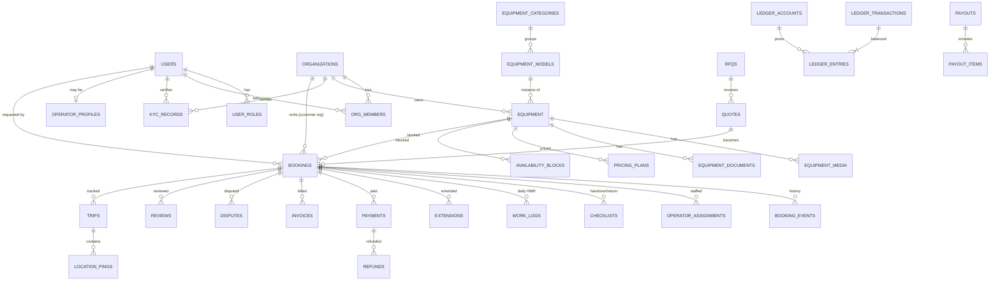

# EQUIPRENT — Database Design

Status: Draft v0.1 · PostgreSQL 18 + PostGIS 3.6 · 2026-11-12

## 1. Conventions

| Rule | Detail |
|---|---|
| Primary keys | `id uuid PRIMARY KEY DEFAULT uuidv7()` |
| Timestamps | `created_at timestamptz NOT NULL DEFAULT now()`, `updated_at` maintained by trigger |
| Money | `bigint` in **paise** (₹1 = 100). Column suffix `_paise`. Never `float` / `numeric` for stored amounts |
| Percent / rates | `integer` basis points (`1000` = 10.00%), suffix `_bps` |
| Enums | PostgreSQL `ENUM` types for stable sets (status). Lookup tables for admin-editable sets (categories, cancellation policies) |
| Geo | `geography(Point,4326)`. GiST index |
| Periods | `tstzrange` for rental windows. `btree_gist` exclusion constraints |
| Phone | E.164 text (`+919876543210`), unique |
| Optimistic locking | `version integer NOT NULL DEFAULT 1` on `bookings`, `equipment`, `payouts` |
| Naming | snake_case, plural table names, FK `<entity>_id` |
| Extensions | `postgis`, `btree_gist`, `pg_trgm`, `citext` |
| PII | KYC numbers encrypted at application level (AES-256-GCM, envelope key in KMS). Searchable hash column where lookup is needed |

## 2. Domain map



## 3. Identity and organisations

```sql
CREATE TYPE role_code AS ENUM ('customer','owner','operator','fleet_manager','admin');
CREATE TYPE admin_scope AS ENUM ('super','ops','kyc','finance','support');

CREATE TABLE users (
  id               uuid PRIMARY KEY DEFAULT uuidv7(),
  phone            text UNIQUE NOT NULL,          -- E.164
  phone_verified_at timestamptz,
  email            citext UNIQUE,
  full_name        text,
  preferred_lang   text NOT NULL DEFAULT 'en',
  avatar_object_key text,
  password_hash    text,                          -- admins only (argon2id)
  totp_secret_enc  bytea,                         -- admins only
  status           text NOT NULL DEFAULT 'active' CHECK (status IN ('active','suspended','deleted')),
  created_at timestamptz NOT NULL DEFAULT now(),
  updated_at timestamptz NOT NULL DEFAULT now()
);

CREATE TABLE user_roles (
  user_id   uuid NOT NULL REFERENCES users(id),
  role      role_code NOT NULL,
  admin_scope admin_scope,                        -- only when role='admin'
  granted_by uuid REFERENCES users(id),
  granted_at timestamptz NOT NULL DEFAULT now(),
  PRIMARY KEY (user_id, role, admin_scope)
);

CREATE TYPE org_type AS ENUM ('individual','proprietorship','partnership','llp','private_ltd','public_ltd','government','other');

CREATE TABLE organizations (
  id            uuid PRIMARY KEY DEFAULT uuidv7(),
  legal_name    text NOT NULL,
  display_name  text NOT NULL,
  org_type      org_type NOT NULL,
  is_supplier   boolean NOT NULL DEFAULT false,   -- owns/rents out equipment
  is_buyer      boolean NOT NULL DEFAULT true,    -- rents equipment
  gstin         text,                             -- 15 chars, validated
  gst_state_code char(2),
  pan_enc       bytea, pan_hash bytea,            -- encrypted + lookup hash
  kyc_status    text NOT NULL DEFAULT 'pending' CHECK (kyc_status IN ('pending','submitted','verified','rejected')),
  billing_address_id uuid,
  rating_avg    numeric(3,2), rating_count integer NOT NULL DEFAULT 0,
  created_at timestamptz NOT NULL DEFAULT now(), updated_at timestamptz NOT NULL DEFAULT now()
);

CREATE TYPE org_member_role AS ENUM ('org_admin','fleet_manager','operator','site_engineer','accountant','member');

CREATE TABLE org_members (
  org_id   uuid NOT NULL REFERENCES organizations(id),
  user_id  uuid NOT NULL REFERENCES users(id),
  role     org_member_role NOT NULL,
  status   text NOT NULL DEFAULT 'active' CHECK (status IN ('invited','active','removed')),
  invited_by uuid REFERENCES users(id),
  created_at timestamptz NOT NULL DEFAULT now(),
  PRIMARY KEY (org_id, user_id, role)
);
```

Every individual user gets a **personal organisation** (`org_type='individual'`) at signup, so bookings, equipment and invoices always reference an org. That gives one code path for individuals and companies.

Supporting tables:
- `otp_challenges(id, phone, code_hash, purpose, attempts, expires_at, consumed_at, ip, device_id)`
- `sessions(id, user_id, refresh_token_hash, device_id, device_name, platform, ip, user_agent, expires_at, revoked_at, last_used_at)`
- `devices(id, user_id, fcm_token, platform, app_version, last_seen_at)`
- `operator_profiles(user_id PK, licence_no_enc, licence_class, licence_expiry, experience_years, categories uuid[], verified_at, rating_avg)`
- `addresses(id, org_id, label, line1, line2, city, district, state_code, pincode, location geography(Point,4326), is_site boolean)`
- `consents(id, user_id, purpose, notice_version, granted_at, withdrawn_at)` (DPDP)

## 4. KYC

```sql
CREATE TYPE kyc_doc_type AS ENUM ('pan','gstin','aadhaar_ref','driving_licence','bank_account','udyam','cin','rc','insurance','fitness','puc','other');

CREATE TABLE kyc_records (
  id          uuid PRIMARY KEY DEFAULT uuidv7(),
  org_id      uuid REFERENCES organizations(id),
  user_id     uuid REFERENCES users(id),
  doc_type    kyc_doc_type NOT NULL,
  number_enc  bytea,               -- never raw Aadhaar; aadhaar_ref stores vendor reference only
  number_last4 text,
  object_key  text,                -- private bucket
  provider    text,                -- e.g. digilocker / pan-api / pennydrop
  provider_ref text,
  provider_response jsonb,         -- minimised, no raw biometrics/Aadhaar
  status      text NOT NULL DEFAULT 'submitted' CHECK (status IN ('submitted','auto_verified','verified','rejected','expired')),
  reviewed_by uuid REFERENCES users(id),
  review_note text,
  expires_on  date,
  created_at timestamptz NOT NULL DEFAULT now(),
  CHECK (org_id IS NOT NULL OR user_id IS NOT NULL)
);

CREATE TABLE bank_accounts (
  id uuid PRIMARY KEY DEFAULT uuidv7(),
  org_id uuid NOT NULL REFERENCES organizations(id),
  account_holder text NOT NULL,
  account_no_enc bytea NOT NULL, account_last4 text NOT NULL,
  ifsc text NOT NULL,
  vpa text,                                        -- optional UPI ID for payouts
  gateway_linked_account_id text,                  -- PA "linked account" for split settlement
  verified_at timestamptz,
  is_primary boolean NOT NULL DEFAULT false
);
```

## 5. Catalogue and listings

```sql
CREATE TABLE equipment_categories (
  id uuid PRIMARY KEY DEFAULT uuidv7(),
  parent_id uuid REFERENCES equipment_categories(id),
  slug text UNIQUE NOT NULL,                 -- 'excavator', 'backhoe-loader'
  name jsonb NOT NULL,                       -- {"en":"Excavator","hi":"खुदाई मशीन"}
  spec_schema jsonb NOT NULL DEFAULT '{}',   -- JSON schema of category-specific specs
  icon_key text, sort_order int NOT NULL DEFAULT 0, is_active boolean NOT NULL DEFAULT true
);

CREATE TABLE equipment_makes (id uuid PRIMARY KEY DEFAULT uuidv7(), name text UNIQUE NOT NULL);

CREATE TABLE equipment_models (
  id uuid PRIMARY KEY DEFAULT uuidv7(),
  category_id uuid NOT NULL REFERENCES equipment_categories(id),
  make_id uuid NOT NULL REFERENCES equipment_makes(id),
  name text NOT NULL,
  specs jsonb NOT NULL DEFAULT '{}',          -- operating_weight_kg, bucket_m3, hp, max_lift_t ...
  UNIQUE (make_id, name)
);

CREATE TYPE listing_status AS ENUM ('draft','pending_review','active','paused','rejected','suspended','retired');

CREATE TABLE equipment (
  id               uuid PRIMARY KEY DEFAULT uuidv7(),
  owner_org_id     uuid NOT NULL REFERENCES organizations(id),
  model_id         uuid NOT NULL REFERENCES equipment_models(id),
  title            text NOT NULL,
  description      text,
  manufacture_year smallint,
  registration_no  text,                      -- for road-going CEV
  serial_no        text,
  current_hmr      numeric(10,1),
  specs_override   jsonb NOT NULL DEFAULT '{}',
  base_location    geography(Point,4326) NOT NULL,
  base_address_id  uuid REFERENCES addresses(id),
  service_radius_km integer NOT NULL DEFAULT 50,
  wet_hire         boolean NOT NULL DEFAULT true,   -- with operator available
  dry_hire         boolean NOT NULL DEFAULT false,
  fuel_policy      text NOT NULL DEFAULT 'customer' CHECK (fuel_policy IN ('customer','owner','shared')),
  instant_book     boolean NOT NULL DEFAULT false,
  status           listing_status NOT NULL DEFAULT 'draft',
  rating_avg numeric(3,2), rating_count int NOT NULL DEFAULT 0,
  version int NOT NULL DEFAULT 1,
  created_at timestamptz NOT NULL DEFAULT now(), updated_at timestamptz NOT NULL DEFAULT now()
);
CREATE INDEX equipment_geo_idx    ON equipment USING gist (base_location);
CREATE INDEX equipment_status_idx ON equipment (status, model_id);
CREATE INDEX equipment_title_trgm ON equipment USING gin (title gin_trgm_ops);

CREATE TABLE equipment_media (
  id uuid PRIMARY KEY DEFAULT uuidv7(),
  equipment_id uuid NOT NULL REFERENCES equipment(id) ON DELETE CASCADE,
  object_key text NOT NULL, kind text NOT NULL CHECK (kind IN ('photo','video')),
  sort_order int NOT NULL DEFAULT 0, width int, height int
);

CREATE TABLE equipment_documents (
  id uuid PRIMARY KEY DEFAULT uuidv7(),
  equipment_id uuid NOT NULL REFERENCES equipment(id),
  doc_type kyc_doc_type NOT NULL,             -- rc / insurance / fitness / puc / other
  object_key text NOT NULL, number text, valid_from date, valid_until date,
  status text NOT NULL DEFAULT 'submitted' CHECK (status IN ('submitted','verified','rejected','expired'))
);

CREATE TYPE price_unit AS ENUM ('hour','shift','day','week','month');

CREATE TABLE pricing_plans (
  id uuid PRIMARY KEY DEFAULT uuidv7(),
  equipment_id uuid NOT NULL REFERENCES equipment(id) ON DELETE CASCADE,
  unit price_unit NOT NULL,
  with_operator boolean NOT NULL DEFAULT true,
  rate_paise bigint NOT NULL CHECK (rate_paise > 0),
  min_units int NOT NULL DEFAULT 1,           -- e.g. min 4 hours
  included_hours numeric(6,1),                -- shift=8, month=200
  extra_hour_rate_paise bigint,
  operator_bata_per_day_paise bigint NOT NULL DEFAULT 0,
  is_active boolean NOT NULL DEFAULT true,
  UNIQUE (equipment_id, unit, with_operator)
);

CREATE TABLE mobilisation_rates (
  equipment_id uuid PRIMARY KEY REFERENCES equipment(id) ON DELETE CASCADE,
  fixed_paise bigint NOT NULL DEFAULT 0,
  per_km_paise bigint NOT NULL DEFAULT 0,
  free_km int NOT NULL DEFAULT 0,
  needs_trailer boolean NOT NULL DEFAULT true
);

CREATE TABLE availability_blocks (
  id uuid PRIMARY KEY DEFAULT uuidv7(),
  equipment_id uuid NOT NULL REFERENCES equipment(id) ON DELETE CASCADE,
  period tstzrange NOT NULL,
  reason text NOT NULL CHECK (reason IN ('owner_block','maintenance','offline_booking')),
  note text,
  EXCLUDE USING gist (equipment_id WITH =, period WITH &&)
);
```

## 6. Request for quote and quotes

```sql
CREATE TABLE rfqs (
  id uuid PRIMARY KEY DEFAULT uuidv7(),
  customer_org_id uuid NOT NULL REFERENCES organizations(id),
  requested_by uuid NOT NULL REFERENCES users(id),
  category_id uuid NOT NULL REFERENCES equipment_categories(id),
  spec_filters jsonb NOT NULL DEFAULT '{}',
  site_address_id uuid NOT NULL REFERENCES addresses(id),
  site_location geography(Point,4326) NOT NULL,
  period tstzrange NOT NULL,
  expected_hours numeric(7,1),
  with_operator boolean NOT NULL DEFAULT true,
  notes text,
  status text NOT NULL DEFAULT 'open' CHECK (status IN ('open','closed','expired','cancelled')),
  expires_at timestamptz NOT NULL
);

CREATE TABLE quotes (
  id uuid PRIMARY KEY DEFAULT uuidv7(),
  rfq_id uuid REFERENCES rfqs(id),                 -- null for direct listing requests
  equipment_id uuid NOT NULL REFERENCES equipment(id),
  owner_org_id uuid NOT NULL REFERENCES organizations(id),
  price_breakdown jsonb NOT NULL,                  -- snapshot (see §7 price snapshot)
  total_paise bigint NOT NULL,
  valid_until timestamptz NOT NULL,
  status text NOT NULL DEFAULT 'offered' CHECK (status IN ('offered','countered','accepted','rejected','expired','withdrawn')),
  parent_quote_id uuid REFERENCES quotes(id)       -- negotiation chain
);
```

## 7. Bookings

```sql
CREATE TYPE booking_status AS ENUM (
  'requested','quoted','accepted','payment_pending','confirmed',
  'operator_assigned','dispatched','on_site','active','return_initiated',
  'returned','completed','closed',
  'rejected','expired','cancelled','disputed'
);

CREATE TABLE bookings (
  id               uuid PRIMARY KEY DEFAULT uuidv7(),
  reference        text UNIQUE NOT NULL,          -- human: ER-2611-4X7K
  equipment_id     uuid NOT NULL REFERENCES equipment(id),
  owner_org_id     uuid NOT NULL REFERENCES organizations(id),
  customer_org_id  uuid NOT NULL REFERENCES organizations(id),
  requested_by     uuid NOT NULL REFERENCES users(id),
  quote_id         uuid REFERENCES quotes(id),
  site_address_id  uuid NOT NULL REFERENCES addresses(id),
  site_location    geography(Point,4326) NOT NULL,
  site_geofence_m  integer NOT NULL DEFAULT 300,
  period           tstzrange NOT NULL,            -- planned window
  actual_period    tstzrange,                     -- on_site .. returned
  with_operator    boolean NOT NULL,
  pricing_unit     price_unit NOT NULL,
  price_snapshot   jsonb NOT NULL,                -- immutable copy of rates, fees, tax rules at confirmation
  estimated_total_paise bigint NOT NULL,
  final_total_paise bigint,
  deposit_paise    bigint NOT NULL DEFAULT 0,
  cancellation_policy_id uuid,
  payment_mode     text NOT NULL DEFAULT 'online' CHECK (payment_mode IN ('online','offline','credit')),
  status           booking_status NOT NULL DEFAULT 'requested',
  status_changed_at timestamptz NOT NULL DEFAULT now(),
  owner_response_due_at timestamptz,
  work_description text,
  version          int NOT NULL DEFAULT 1,
  created_at timestamptz NOT NULL DEFAULT now(), updated_at timestamptz NOT NULL DEFAULT now()
);

-- The double-booking guard: no two "holding" bookings for one machine may overlap.
ALTER TABLE bookings ADD CONSTRAINT bookings_no_overlap
  EXCLUDE USING gist (equipment_id WITH =, period WITH &&)
  WHERE (status IN ('accepted','payment_pending','confirmed','operator_assigned',
                    'dispatched','on_site','active','return_initiated'));

CREATE INDEX bookings_customer_idx ON bookings (customer_org_id, created_at DESC);
CREATE INDEX bookings_owner_idx    ON bookings (owner_org_id, status, created_at DESC);

CREATE TABLE booking_events (            -- append-only state history + audit
  id bigint GENERATED ALWAYS AS IDENTITY PRIMARY KEY,
  booking_id uuid NOT NULL REFERENCES bookings(id),
  from_status booking_status, to_status booking_status NOT NULL,
  actor_user_id uuid REFERENCES users(id), actor_role text,
  reason text, payload jsonb,
  created_at timestamptz NOT NULL DEFAULT now()
);
```

Overlaps against `availability_blocks` are checked in the same transaction (`SELECT … FOR UPDATE` on the equipment row, then an overlap query). Bookings are guarded by the exclusion constraint.

Related booking tables:

| Table | Key columns |
|---|---|
| `operator_assignments` | `booking_id, operator_user_id, assigned_by, period tstzrange, status (assigned/accepted/declined/replaced)`, with exclusion constraint per operator to prevent double-assigning |
| `checklists` | `booking_id, kind (handover/return), hmr_reading numeric, hmr_photo_key, fuel_level, items jsonb, damage_notes, location geography, captured_at, submitted_by, customer_otp_verified_at, client_id uuid UNIQUE` |
| `checklist_photos` | `checklist_id, object_key, angle, captured_at, location` |
| `work_logs` | `booking_id, work_date date, start_hmr, end_hmr, hours numeric(5,1), idle_hours, breakdown_hours, fuel_litres, submitted_by, status (submitted/approved/disputed/auto_approved), approved_by, approved_at, client_id UNIQUE`, `UNIQUE(booking_id, work_date)` |
| `breakdowns` | `booking_id, reported_by, reported_at, resolved_at, description, photos, replacement_equipment_id` |
| `extensions` | `booking_id, new_end timestamptz, status, price_delta_paise, requested_by, decided_by` |
| `cancellation_policies` | `id, name, rules jsonb` (e.g. `[{"hours_before":24,"fee_bps":0},{"hours_before":0,"fee_bps":2500}]`) |

## 8. Payments, ledger, invoices, payouts

### 8.1 Payments

```sql
CREATE TYPE payment_purpose AS ENUM ('advance','deposit','balance','extension','damage','cancellation_fee');
CREATE TYPE payment_status AS ENUM ('created','authorized','captured','failed','refunded','partially_refunded');

CREATE TABLE payments (
  id uuid PRIMARY KEY DEFAULT uuidv7(),
  booking_id uuid NOT NULL REFERENCES bookings(id),
  payer_org_id uuid NOT NULL REFERENCES organizations(id),
  purpose payment_purpose NOT NULL,
  amount_paise bigint NOT NULL CHECK (amount_paise > 0),
  method text,                                   -- upi / card / netbanking / offline_cash / offline_neft
  gateway text,                                  -- razorpay / cashfree / offline
  gateway_order_id text UNIQUE,
  gateway_payment_id text UNIQUE,
  status payment_status NOT NULL DEFAULT 'created',
  idempotency_key text UNIQUE NOT NULL,
  offline_proof_key text, offline_confirmed_by uuid REFERENCES users(id),
  raw_last_webhook jsonb,
  created_at timestamptz NOT NULL DEFAULT now(), updated_at timestamptz NOT NULL DEFAULT now()
);

CREATE TABLE refunds (
  id uuid PRIMARY KEY DEFAULT uuidv7(),
  payment_id uuid NOT NULL REFERENCES payments(id),
  amount_paise bigint NOT NULL CHECK (amount_paise > 0),
  reason text NOT NULL,
  gateway_refund_id text UNIQUE,
  status text NOT NULL DEFAULT 'pending' CHECK (status IN ('pending','processed','failed')),
  initiated_by uuid REFERENCES users(id)
);

CREATE TABLE webhook_events (           -- inbox: dedupe + replay
  id uuid PRIMARY KEY DEFAULT uuidv7(),
  provider text NOT NULL, event_id text NOT NULL, event_type text NOT NULL,
  payload jsonb NOT NULL, signature_valid boolean NOT NULL,
  received_at timestamptz NOT NULL DEFAULT now(), processed_at timestamptz, error text,
  UNIQUE (provider, event_id)
);
```

### 8.2 Double-entry ledger

Every money movement is a balanced `ledger_transaction` (sum of debits = sum of credits). Balances are derived, never stored as mutable truth.

```sql
CREATE TABLE ledger_accounts (
  id uuid PRIMARY KEY DEFAULT uuidv7(),
  code text UNIQUE NOT NULL,     -- e.g. 'gateway_clearing', 'platform_revenue:commission',
                                 -- 'owner_payable:{org_id}', 'customer_deposit:{booking_id}',
                                 -- 'gst_output', 'tcs_payable', 'tds_194o_payable', 'gateway_fees'
  type text NOT NULL CHECK (type IN ('asset','liability','revenue','expense','equity')),
  org_id uuid REFERENCES organizations(id)
);

CREATE TABLE ledger_transactions (
  id uuid PRIMARY KEY DEFAULT uuidv7(),
  kind text NOT NULL,             -- payment_captured / commission / payout / refund / tax / adjustment
  booking_id uuid REFERENCES bookings(id),
  reference_type text, reference_id uuid,
  memo text,
  created_by uuid REFERENCES users(id),
  created_at timestamptz NOT NULL DEFAULT now()
);

CREATE TABLE ledger_entries (
  id bigint GENERATED ALWAYS AS IDENTITY PRIMARY KEY,
  transaction_id uuid NOT NULL REFERENCES ledger_transactions(id),
  account_id uuid NOT NULL REFERENCES ledger_accounts(id),
  direction char(1) NOT NULL CHECK (direction IN ('D','C')),
  amount_paise bigint NOT NULL CHECK (amount_paise > 0)
);
-- Balanced-ness enforced by a deferred constraint trigger per transaction_id.
-- ledger_* tables are INSERT-only (UPDATE/DELETE revoked from app role).
```

Example: customer pays ₹30,000 advance (rental ₹25,000 + GST ₹4,500 + platform fee ₹500 incl. GST)

| Account | D | C |
|---|---|---|
| gateway_clearing | 30,000 | |
| owner_payable:{owner} | | 29,500 |
| platform_revenue:convenience_fee (net) + gst_output (on fee) | | 500 |

On completion: commission 10% of ₹25,000 = ₹2,500 + 18% GST.

| Account | D | C |
|---|---|---|
| owner_payable:{owner} | 2,950 | |
| platform_revenue:commission | | 2,500 |
| gst_output | | 450 |

Then TCS / TDS-194O withholding moves from `owner_payable` to `tcs_payable` / `tds_194o_payable`. Payout debits `owner_payable` and credits `gateway_clearing`.

### 8.3 Invoices

| Table | Notes |
|---|---|
| `invoice_series` | `(issuer_org_id, financial_year, prefix, next_number)`. Gap-free numbering per GST rules, incremented under row lock |
| `invoices` | `id, number, issuer_org_id, recipient_org_id, booking_id, type (rental / commission / convenience_fee / credit_note), place_of_supply char(2), supply_type (intra/inter), subtotal_paise, cgst_paise, sgst_paise, igst_paise, total_paise, sac_code, pdf_object_key, irn (future), issued_at, status` |
| `invoice_lines` | `invoice_id, description, sac_code, quantity numeric, unit, rate_paise, taxable_paise, gst_rate_bps` |

Rental invoices are issued **in the owner's name** (the owner is the supplier). The platform issues its own invoices for commission (to the owner) and convenience fee (to the customer).

### 8.4 Payouts

| Table | Notes |
|---|---|
| `settlements` | One per completed booking: `booking_id UNIQUE, gross_paise, commission_paise, gst_on_commission_paise, tcs_paise, tds_paise, deductions_paise, net_payable_paise, eligible_at, status (pending/on_hold/eligible/paid)` |
| `payouts` | `id, owner_org_id, bank_account_id, amount_paise, gateway_transfer_id UNIQUE, status (queued/processing/paid/failed/reversed), batch_date, version` |
| `payout_items` | `payout_id, settlement_id UNIQUE` |
| `commission_rules` | `id, category_id null, city null, owner_org_id null, commission_bps, customer_fee_bps, valid_from, valid_to, priority`. The most specific match wins |

## 9. Tracking

```sql
CREATE TABLE trips (
  id uuid PRIMARY KEY DEFAULT uuidv7(),
  booking_id uuid NOT NULL REFERENCES bookings(id),
  equipment_id uuid NOT NULL REFERENCES equipment(id),
  operator_user_id uuid REFERENCES users(id),
  kind text NOT NULL CHECK (kind IN ('mobilisation','on_site','demobilisation')),
  started_at timestamptz NOT NULL, ended_at timestamptz,
  distance_m integer, route geography(LineString,4326)   -- simplified polyline at close
);

CREATE TABLE location_pings (
  trip_id uuid NOT NULL,
  equipment_id uuid NOT NULL,
  recorded_at timestamptz NOT NULL,
  received_at timestamptz NOT NULL DEFAULT now(),
  location geography(Point,4326) NOT NULL,
  accuracy_m real, speed_mps real, heading smallint, battery smallint,
  source text NOT NULL DEFAULT 'app'          -- app / telematics
) PARTITION BY RANGE (recorded_at);
-- monthly partitions created by a job; BRIN index on recorded_at, btree (trip_id, recorded_at)
-- retention: drop partitions older than 90 days (configurable; longer while a dispute is open → copy to evidence)

CREATE TABLE geofence_events (
  id uuid PRIMARY KEY DEFAULT uuidv7(),
  booking_id uuid NOT NULL REFERENCES bookings(id),
  event text NOT NULL CHECK (event IN ('enter_site','exit_site')),
  occurred_at timestamptz NOT NULL, location geography(Point,4326)
);
```

Live "last known position" is in Redis only (`machine:{id}:last`), with a snapshot to `equipment_last_location` every few minutes for fleet map cold loads.

## 10. Fleet and maintenance

- `maintenance_plans(equipment_id, every_hours, every_days, task)`
- `maintenance_records(id, equipment_id, performed_at, hmr_at, task, cost_paise, vendor, notes, attachments)`
- Utilisation is derived: `sum(work_logs.hours) / available_hours` per period, as a materialised view refreshed nightly.

## 11. Trust, support, platform

| Table | Purpose |
|---|---|
| `reviews` | `booking_id, reviewer_org_id, subject_type (equipment/owner_org/operator/customer_org), subject_id, rating 1–5, comment, status`. `UNIQUE(booking_id, reviewer_org_id, subject_type)` |
| `disputes` | `booking_id, raised_by, category (hmr/damage/payment/no_show/quality/other), amount_claimed_paise, status (open/under_review/resolved/rejected), resolution jsonb, assigned_admin` |
| `dispute_messages` | Thread with attachments |
| `notifications` | `user_id, type, title, body, data jsonb, channel set, read_at` |
| `notification_templates` | `code, channel, lang, body, dlt_template_id` |
| `audit_logs` | `actor_user_id, actor_role, action, entity_type, entity_id, before jsonb, after jsonb, ip, user_agent, request_id, created_at`. Append-only, partitioned monthly |
| `outbox_events` | `id, aggregate_type, aggregate_id, event_type, payload, created_at, published_at` |
| `idempotency_keys` | `key, user_id, method, path, request_hash, response_status, response_body, created_at` (TTL 24–72h, could live in Redis + DB for money endpoints) |
| `feature_flags`, `app_settings` | Runtime config |
| `cities` | `id, name, state_code, center geography, is_live`. Drives availability and commission rules |

## 12. Search query sketch

```sql
-- name: SearchEquipment :many
SELECT e.id, e.title, m.name AS model, ST_Distance(e.base_location, @site::geography) AS distance_m,
       p.rate_paise, p.unit, e.rating_avg
FROM equipment e
JOIN equipment_models m ON m.id = e.model_id
JOIN pricing_plans p ON p.equipment_id = e.id AND p.unit = @unit AND p.with_operator = @with_operator AND p.is_active
WHERE e.status = 'active'
  AND m.category_id = ANY(@category_ids::uuid[])
  AND ST_DWithin(e.base_location, @site::geography, LEAST(e.service_radius_km, @max_km) * 1000)
  AND NOT EXISTS (SELECT 1 FROM bookings b WHERE b.equipment_id = e.id
                  AND b.period && @period::tstzrange
                  AND b.status IN ('accepted','payment_pending','confirmed','operator_assigned','dispatched','on_site','active','return_initiated'))
  AND NOT EXISTS (SELECT 1 FROM availability_blocks a WHERE a.equipment_id = e.id AND a.period && @period::tstzrange)
ORDER BY distance_m
LIMIT @lim;
```

## 13. Data retention

| Data | Retention |
|---|---|
| Invoices, ledger, payments, payouts | 8 years (Income Tax / GST books of account), then archive |
| Booking records, checklists, work logs | 8 years (they support invoices) |
| KYC documents | Duration of relationship + period required by law. Delete or anonymise on account closure where allowed |
| Location pings | 90 days default. Kept with dispute evidence while a dispute is open |
| Server/security logs | 180 days minimum (CERT-In) |
| OTP challenges | 30 days |
| Marketing data | Until consent withdrawn |

## 14. Migration and code-gen workflow

1. Run `scriptsmigrate.ps1 create <name>` and write `backend/migrations/NNNNNN_name.up.sql` + `.down.sql` (golang-migrate).
2. Write queries in `db/queries/<module>.sql` with sqlc annotations.
3. Run `sqlc generate`. Each module gets its own package via sqlc's multiple `queries` configs.
4. CI runs `sqlc vet` + `sqlc diff` + migrations against a fresh PostGIS container.
