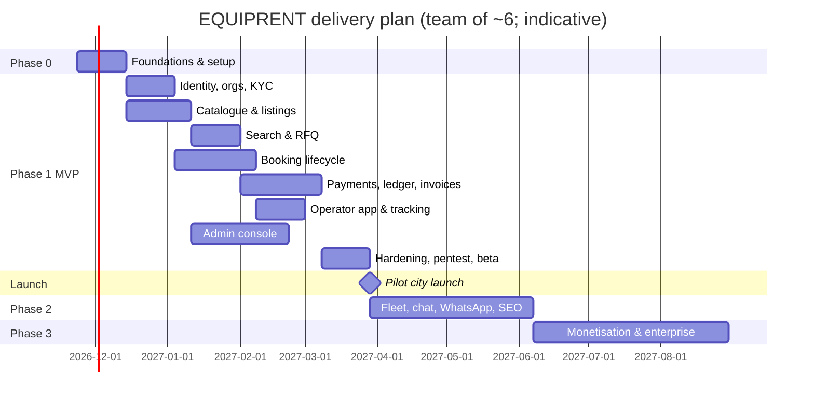

# EQUIPRENT — Development Roadmap

Status: Draft v0.1 · 2026-11-12. Timelines assume a small team (2 backend, 2 Flutter, 1 QA, part-time design). For a solo + AI-assisted build, multiply by ~1.8.

## 1. Development environment audit (this machine, 2026-11-12)

Machine: Windows 11 Home 25H2 · 11.8 GB RAM · **15.7 GB free on C:**

| Tool | Required | Found | Status |
|---|---|---|---|
| Go | 1.25+ | **go1.26.5** windows/amd64, on PATH | ✅ |
| Flutter / Dart | 3.3x+ / 3.x | **Flutter 3.44.7 stable / Dart 3.12.2** at `C:\flutter\bin` | ⚠️ not on PATH |
| Git | any | **2.55.0** at `C:\Program Files\Git\cmd` | ⚠️ not on PATH (Flutter fails without it). No global `user.name` / `user.email` set |
| PostgreSQL | 18 | **18.4**, service `postgresql-x64-18` running | ⚠️ bin not on PATH. **PostGIS not installed** |
| PostGIS | 3.5+ | – | ❌ missing (use Docker image, or install via StackBuilder) |
| Redis | 7+ | – | ❌ missing (Docker) |
| MinIO (S3-compatible) | any | – | ❌ missing (Docker) |
| Docker | 24+ | **Docker CLI 29.6.2** (Docker Desktop installed) | ⚠️ **engine not running. No WSL distro found.** Docker Desktop needs WSL 2 |
| sqlc | 1.27+ | – | ❌ `go install github.com/sqlc-dev/sqlc/cmd/sqlc@latest` |
| golang-migrate | 4.x | – | ❌ `go install -tags pgx5 github.com/golang-migrate/migrate/v4/cmd/migrate@v4.20.1` |
| golangci-lint | 2.x | – | ❌ optional for local, required in CI |
| air (hot reload) | – | – | optional |
| gopls | – | ✅ in `%USERPROFILE%\go\bin` | ✅ |
| Node.js | – | v24.18.0 | ✅ (only for tooling such as OpenAPI linters) |
| Android SDK | 34+ platform | platforms 22/29/33/34, build-tools ≤34.0.0, platform-tools | ⚠️ **cmdline-tools missing**, `ANDROID_HOME` unset. Recent Flutter wants platform 35/36 |
| JDK 17/21 | for Gradle | `JAVA_HOME` → `C:\Program Files\Java\jdk-20` **which does not exist**. Android Studio's bundled JBR is **incomplete/broken** (`jvm.cfg` missing) | ❌ Android builds blocked |
| Web browser for Flutter web | Chrome/Edge | Edge detected (doctor ✓) | ✅ Use `--no-web-resources-cdn` |
| Visual Studio C++ workload | only for Windows desktop builds | missing | ➖ not needed |
| Xcode / macOS | iOS builds | not possible on Windows | ❌ Use **Codemagic** (cloud macOS) or a Mac for iOS |

### 1.1 Problems worth fixing first
1. **Disk space (15.7 GB free)** is the biggest risk. Docker Desktop + PostGIS/Redis/MinIO images (~2–3 GB), an Android emulator image (~6–8 GB), Gradle caches (~3–5 GB) and Flutter build artefacts will fill C:. Free up at least **30 GB**, or move Docker's disk image and the Android AVD folder to another drive. **Test on a physical Android phone** instead of an emulator (saves disk and RAM).
2. **The project lives inside OneDrive.** OneDrive syncing `.dart_tool`, `build/`, Gradle and Go caches causes file-lock errors and slow builds. Move the repo to e.g. `C:\dev\equiprent`, or mark the folder "Always keep on this device" and exclude build folders. Moving is strongly recommended.
3. **Docker Desktop needs WSL 2.** Run `wsl --install` (admin, reboot), then start Docker Desktop.
4. **Broken Java.** Install **Temurin JDK 17** (or repair Android Studio, which re-installs its JBR). Then set `JAVA_HOME` and run `flutter config --jdk-dir`.
5. **Android cmdline-tools.** Android Studio → SDK Manager → SDK Tools → *Android SDK Command-line Tools (latest)* + Platform 35/36. Then `flutter doctor --android-licenses`.
6. **PATH.** Add `C:\flutter\bin`, `C:\Program Files\Git\cmd`, `C:\Program Files\PostgreSQL\18\bin`, `%USERPROFILE%\go\bin`. Set `ANDROID_HOME=%LOCALAPPDATA%\Android\Sdk`.
7. **PostgreSQL choice.** For dev, use the **PostGIS container on port 5434**, which avoids the native PG 18 service on 5432 and another local cluster already on 5433. That way PostGIS doesn't need installing on Windows, and dev matches production.

### 1.2 Setup commands (to run after approval; nothing has been installed yet)
```powershell
# 1. WSL 2 for Docker (admin PowerShell, reboot after)
wsl --install

# 2. JDK 17
winget install EclipseAdoptium.Temurin.17.JDK

# 3. PATH + env (user scope)
[Environment]::SetEnvironmentVariable('ANDROID_HOME', "$env:LOCALAPPDATA\Android\Sdk", 'User')
# add C:\flutter\bin; C:\Program Files\Git\cmd; C:\Program Files\PostgreSQL\18\bin; %USERPROFILE%\go\bin via System Properties → Environment Variables

# 4. Go tooling
go install github.com/sqlc-dev/sqlc/cmd/sqlc@latest
go install -tags pgx5 github.com/golang-migrate/migrate/v4/cmd/migrate@v4.20.1
go install github.com/air-verse/air@latest
go install github.com/golangci/golangci-lint/v2/cmd/golangci-lint@latest

# 5. Git identity
git config --global user.name  "<your name>"
git config --global user.email "<your email>"

# 6. Verify
flutter doctor -v
docker compose version
```

## 2. Team and workflow

- **Branching:** trunk-based on `main`, short-lived feature branches, PR review required, squash merge.
- **Definition of Done:** code + tests + OpenAPI updated + migration reviewed + feature flag (if risky) + docs + demo on staging.
- **Sprints:** 2 weeks. Demo every sprint to the founder.
- **Tracking:** GitHub Projects / Linear. Epics map to phases below.
- **Quality gates in CI:** lint, unit tests, integration tests (PostGIS testcontainer), `sqlc diff`, OpenAPI lint, `flutter analyze`, widget tests, golden tests for design system.

## 3. Phased roadmap



### Phase 0: Foundations (3 weeks)
**Goal:** a skeleton that builds, tests and deploys end to end.
- Repo layout (monorepo: `backend/`, `apps/mobile`, `apps/web`, `packages/*`, `infra/`, `docs/`).
- Docker Compose: PostGIS, Redis, MinIO, Mailpit.
- Go skeleton: config, pgxpool, slog, error envelope, health checks, middleware chain, golang-migrate + sqlc wiring, OpenAPI skeleton, asynq worker, outbox.
- Flutter skeleton: workspace, design system (brand tokens, typography, light/dark), GoRouter with role shells, Riverpod, Dio client with interceptors, l10n (en/hi), drift outbox, flavors (dev/staging/prod).
- CI pipelines. Staging environment in an India region.
- Legal/ops in parallel: company registration, PA account application, DLT registration, Apple/Google developer accounts, domain.

**Exit:** OTP login (with dev SMS stub) works on Android device + web against staging.

### Phase 1: MVP (≈ 16–18 weeks)
| Epic | Key stories | Exit criteria |
|---|---|---|
| **Identity and KYC** | OTP auth, sessions, roles, personal + company orgs, members/invites, PAN/GSTIN/bank verification, DigiLocker, admin KYC queue | Owner can be verified end-to-end. Admin can approve/reject |
| **Catalogue and listings** | Taxonomy seed (~25 categories, top makes/models in India), listing wizard, photo upload (presigned), documents with expiry, pricing plans, mobilisation, availability calendar, moderation | 1 owner lists a machine. Admin approves. It appears in search |
| **Search and RFQ** | Geo search, filters, map/list, estimate API, RFQ broadcast + quotes | Customer finds machines within 50 km with correct estimates |
| **Booking lifecycle** | State machine, request/accept/counter/expire, exclusion constraint, operator assignment, dispatch, handover OTP, work logs + approvals, extensions, breakdowns, return, inspection, cancellation policies, disputes (admin-mediated) | Full happy path + cancellation + breakdown paths pass E2E tests |
| **Payments and finance** | PA integration (orders, webhooks, split transfers on hold, refunds), deposit, balance, ledger, commission rules, TCS/TDS calculation, settlements, payouts, invoice numbering + PDFs, offline payment recording, daily reconciliation | Sandbox money flows reconcile to the paisa. Invoices validated by CA |
| **Operator app and tracking** | Jobs list, navigation hand-off to maps app, foreground location service, WS ingest, live map for customer, offline outbox | Tracking works on a 2 GB RAM Android 9 device on 3G with app backgrounded |
| **Notifications** | FCM, SMS (DLT templates), email invoices, in-app centre | Matrix in USER_FLOWS §10 implemented |
| **Admin console** | KYC, listings, bookings watchtower, disputes, payouts, config, audit log viewer | Ops can run the pilot without DB access |
| **Hardening** | Load test (k6) on search/booking, security review, external pentest, privacy notices, T&C, grievance page, backups + restore drill, monitoring/alerts | No high/critical findings open. p95 targets met |

**MVP launch:** closed beta with ~30 owners / 100 machines in the pilot city, then public launch in that city. Android first. iOS in the same release if Codemagic + Apple account are ready, otherwise 2–4 weeks later. Web dashboards for owners and admin.

### Phase 2: Growth (≈ 10 weeks after launch)
- Fleet manager dashboard: live map, utilisation, maintenance, operator performance.
- Instant Book for trusted owners.
- In-booking chat. WhatsApp notifications. Call masking.
- Public SEO pages (city × category), sitemap, listing share links.
- Price suggestions from market data. Featured listings.
- Customer orgs: site engineers, approval workflow, TDS (194-I) handling.
- Geofence automation. Bulk CSV listing.
- RLS, Play Integrity, certificate pinning. Additional languages (Marathi, Tamil, Telugu, Kannada, Gujarati).

### Phase 3: Monetisation and enterprise (≈ 12 weeks)
- Owner subscriptions (Fleet plan). Logistics/trailer marketplace.
- Insurance add-on via partner. Credit/BNPL via NBFC partner.
- Monthly contracts with recurring billing. E-invoicing (IRN) via GSP.
- Telematics / OEM API integration (engine hours, location).
- Analytics warehouse. Ops dashboards. Second and third cities.

### Phase 4: Scale (ongoing)
- Split tracking service. TimescaleDB or separate time-series store.
- OpenSearch if needed. Event bus.
- Independent operator marketplace. Used-equipment and spares marketplace.
- Multi-city ops tooling, partner APIs for large contractors (ERP integration).

## 4. Testing strategy

| Layer | Tooling | Focus |
|---|---|---|
| Go unit | `testing` + `testify` | State machine, pricing, tax, commission, ledger balancing (property tests) |
| Go integration | testcontainers (PostGIS, Redis) | sqlc queries, exclusion constraints, webhooks, idempotency |
| API contract | OpenAPI validation in tests. Schemathesis fuzzing in CI nightly | Spec drift, edge inputs |
| Flutter unit/widget | `flutter_test`, `mocktail` | Notifiers, forms, formatting |
| Golden | `alchemist` or built-in goldens | Design system |
| Integration / E2E | `integration_test` + Patrol (native dialogs, permissions) | Booking happy path, operator offline sync |
| Load | k6 | Search, booking creation, 2k concurrent WS trackers |
| Security | gosec, govulncheck, ZAP baseline, external pentest | |
| Device lab | 3–4 real low/mid Android phones + 1 iPhone (or BrowserStack) | Performance on low-end devices |

## 5. Milestones and approval gates

| Gate | Artefact | Approver |
|---|---|---|
| **G0 (now)** | These 7 documents + environment fixes | Founder |
| G1 | Clickable Figma prototype of customer booking + owner listing + operator job | Founder + 5 real owners/contractors interviewed |
| G2 | Phase 0 skeleton running on staging | Founder |
| G3 | Payments design reviewed by CA + PA integration approved | Founder + CA |
| G4 | MVP feature complete on staging, pentest done | Founder |
| G5 | Pilot launch | Founder |

## 6. Immediate next steps once approved

1. You answer the open decisions in [PROJECT_PLAN §12](PROJECT_PLAN.md#12-decisions-needed-from-you-before-development-starts).
2. Fix the environment (§1.1): free disk, move the repo out of OneDrive, WSL 2 + Docker, JDK 17, Android cmdline-tools, PATH.
3. Start Phase 0: scaffold the monorepo, Docker Compose, Go skeleton, Flutter workspace, CI.
4. In parallel (business): company + PA onboarding + DLT registration. These have multi-week lead times.
