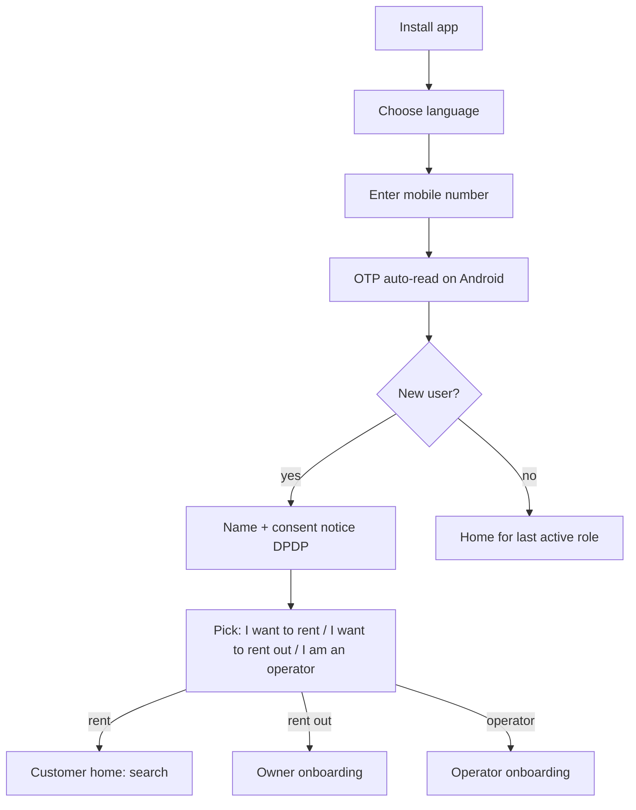
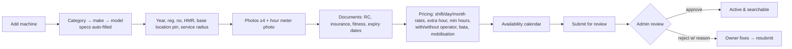
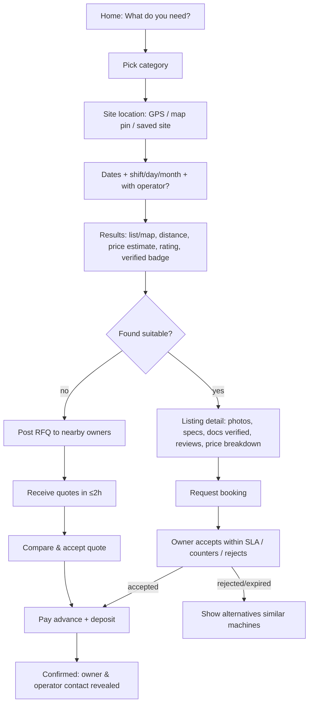
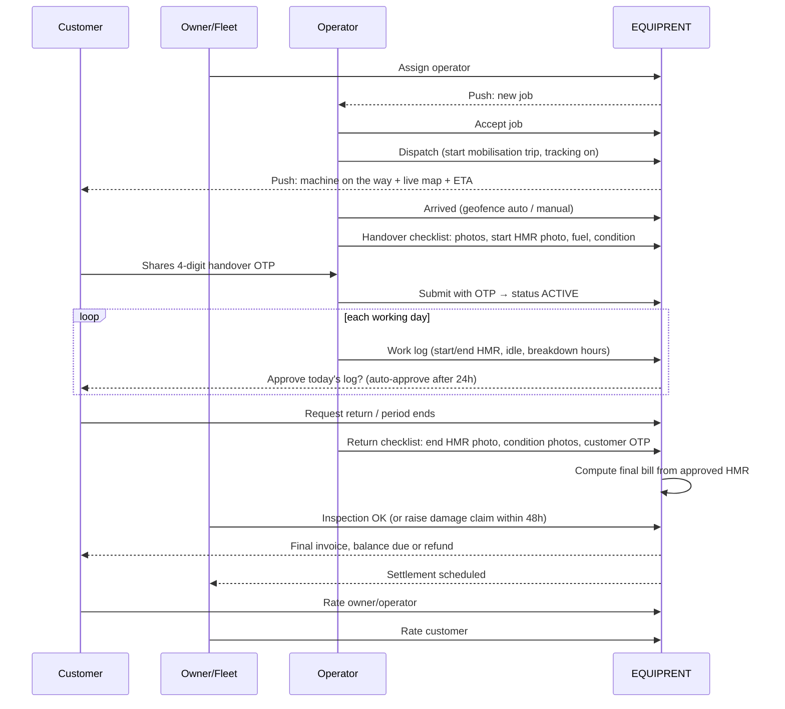
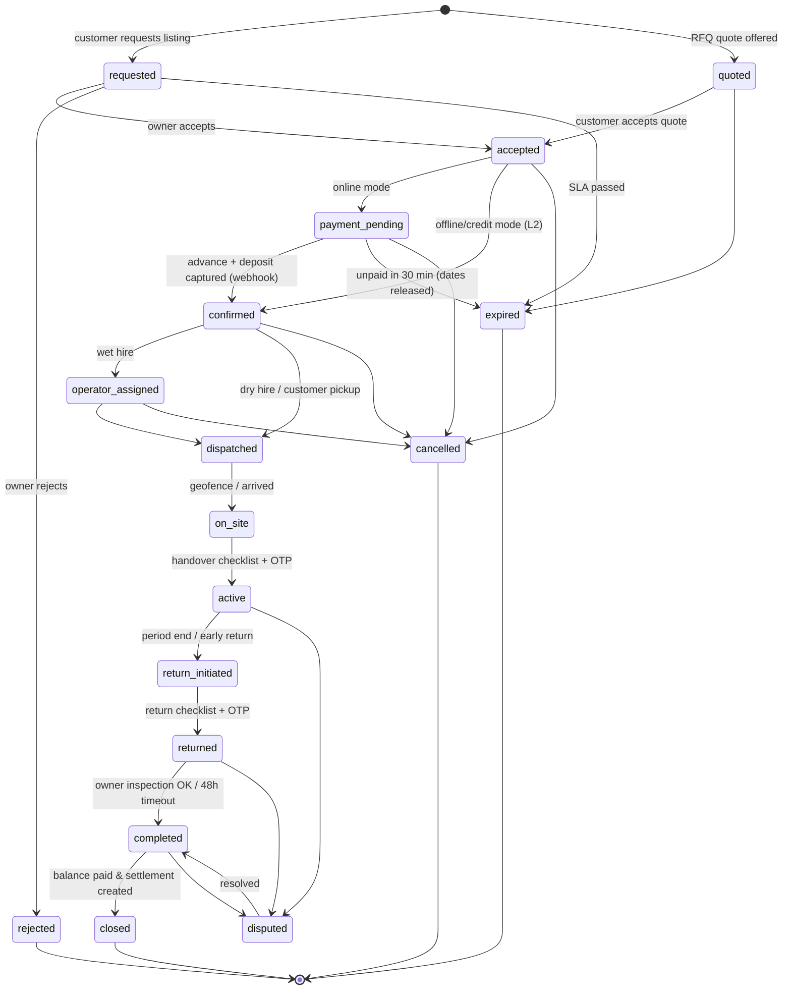
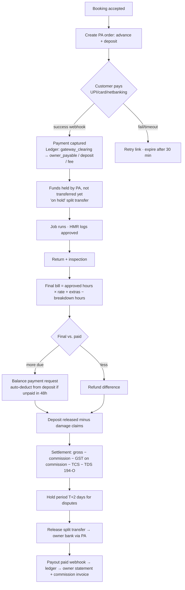

# EQUIPRENT — User Flows and Lifecycles

Status: Draft v0.1 · 2026-11-12

## 1. Personas

| Persona | Snapshot | What they care about |
|---|---|---|
| **Ravi, site contractor (Customer)** | Runs 3–4 small residential sites. Books backhoes and rollers weekly. Android, Hindi/Marathi, WhatsApp-heavy | Machine arrives on time, fair HMR, no haggling every time, GST bill |
| **Meera, procurement at a mid-size builder (Customer org)** | Needs 20-ton excavators for months. Has to raise POs, deduct TDS, get proper invoices | Verified vendors, documentation, monthly billing, approvals |
| **Suresh, owner of 2 JCBs (Owner + Operator)** | Drives one machine himself. Finds work via brokers. Feature phone → recently smartphone | More bookings, guaranteed payment, simple app |
| **Patil Infra, 40-machine fleet (Owner org)** | Has an office, accountant and fleet manager | Utilisation, operator management, payouts, maintenance |
| **Imran, operator (Operator)** | Employed by Patil Infra. Limited reading comfort. Works long shifts at remote sites | Clear job instructions, navigation, quick HMR entry, works without network |
| **Anita, fleet manager** | Manages Patil Infra's machines and 30 operators | Live map, who is where, idle machines, upcoming services |
| **EQUIPRENT ops / KYC / finance staff (Admin)** | Internal | Queues, fast decisions, clean audit trail |

## 2. Onboarding flows

### 2.1 Any user (mobile)

### 2.2 Owner onboarding
1. Choose **Individual** or **Business**. Business: enter GSTIN, which auto-fetches legal name, address and state.
2. PAN verification (mandatory for payouts and TDS).
3. Bank account → penny drop → PA linked account created.
4. Optional at signup but required before first payout: Aadhaar via DigiLocker for individuals.
5. Add first machine (§3) **without waiting for KYC approval**. The listing stays in `pending_review` until both KYC and listing are approved. This keeps time-to-first-listing short.

### 2.3 Operator onboarding
Two paths:
- **Invited by owner / fleet manager**: gets an SMS link, logs in, auto-joins the org as `operator`, uploads licence + photo.
- **Self-signup** (Phase 3: independent operator marketplace). At MVP self-signup operators must link to an owner by code.

### 2.4 Customer verification levels
| Level | Requires | Unlocks |
|---|---|---|
| L0 | Phone OTP | Browse, estimate, RFQ |
| L1 | Name + site address + PAN *or* GSTIN | Book with online payment |
| L2 | Verified GSTIN business + history | Offline/credit payment mode, dry hire, high-value bookings |

## 3. Owner: list a machine

The app suggests prices from category/city medians in Phase 2.

## 4. Customer: find and book

## 5. Job execution (customer + owner + operator)

**Breakdown sub-flow:** Operator or customer reports a breakdown with photo. The clock stops (breakdown hours are excluded from billing). The owner chooses *repair on site* (with ETA), *replace machine* (a new equipment_id is attached to the booking and the replacement goes through dispatch → handover), or *terminate* (pro-rata bill, deposit refund).

**Extension sub-flow:** Customer requests a new end date. Availability is checked. Owner approves. The price delta is charged or added to the final bill per payment mode.

## 6. Booking lifecycle (state machine)

**Rules:**
- The transition table lives in `internal/booking/statemachine.go`: allowed `(from, to, actor_role, guard)`. Every transition writes `booking_events` + `audit_logs` + an outbox event in the same transaction.
- **Slot holding:** dates are held from `accepted` onward, enforced by the DB exclusion constraint. `payment_pending` holds for at most 30 min.
- **Cancellation fees** (default policy, configurable): free until 24h before start. 25% of the first-day rental within 24h. After dispatch, mobilisation charges + one minimum shift. An owner who cancels after confirmation gets a penalty, a reliability score hit, and EQUIPRENT tries to re-match the customer.
- An admin can force any transition, but must give a reason, and it is audited.

## 7. Payment and settlement lifecycle

**Invoices generated:**
1. **Rental tax invoice** from owner to customer, issued at completion (or monthly for long hires). GST per place of supply.
2. **Convenience fee invoice** from EQUIPRENT to customer.
3. **Commission invoice** from EQUIPRENT to owner.
4. **Credit notes** for refunds and adjustments.

**Offline payment mode** (L2 customers or owner's choice): EQUIPRENT doesn't touch the money. The owner records receipts. The platform invoices the owner for commission monthly, collected via UPI Autopay / payment link. Unpaid commission blocks new bookings.

**Long-term hires (monthly):** monthly billing cycles. Each month closes with approved hours and an invoice + payment request. Deposit is held until the end.

## 8. Fleet manager flows

| Flow | Steps |
|---|---|
| Daily standup | Open fleet dashboard → today's jobs → unassigned bookings (red) → assign operators by drag-drop → see live map |
| Idle machines | Filter "idle > 3 days" → pause listing or reduce price → boost (P2) |
| Maintenance | Alert "Service due at 2,500 HMR (current 2,460)" → schedule block → log service + cost |
| Operator management | Invite operator → verify licence → set categories → view performance (on-time, ratings, disputes) |
| Document expiry | Weekly digest of RC/insurance/licence expiring in 30 days. Auto-pause listing on expiry |
| Reports | Utilisation by machine, revenue by month, payouts, TDS/TCS summary for the accountant |

## 9. Admin flows

| Queue | Flow |
|---|---|
| KYC | Auto-verified items show green. Reviewer checks documents → approve / reject with reason template → user notified |
| Listing moderation | Photo quality, matching RC, plausible price → approve / request changes |
| Booking watchtower | Real-time list of SLA breaches: owner not responding, operator not dispatched, machine late → call / reassign |
| Disputes | Evidence panel: timeline, HMR photos, GPS trail, checklists, chat → propose resolution → both parties accept or admin decides → financial adjustment posted to ledger |
| Finance | Daily reconciliation exceptions, payout batch approval, hold/release, TCS/TDS reports |

## 10. Notification matrix (MVP)

| Event | Customer | Owner | Operator | Fleet | Channel |
|---|---|---|---|---|---|
| Booking requested | | ✓ | | ✓ | Push + SMS |
| Owner SLA reminder (50% elapsed) | | ✓ | | ✓ | Push |
| Accepted / rejected / expired | ✓ | | | | Push + SMS |
| Payment captured | ✓ | ✓ | | | Push + email receipt |
| Operator assigned | ✓ | | ✓ | | Push |
| Dispatched (with live link) | ✓ | | | ✓ | Push + SMS |
| Arrived on site | ✓ | ✓ | | ✓ | Push |
| Daily work log for approval | ✓ | | | | Push |
| Breakdown reported | ✓ | ✓ | | ✓ | Push + SMS |
| Return completed / final bill | ✓ | ✓ | | | Push + email (invoice PDF) |
| Payout sent | | ✓ | | | Push + SMS |
| Document expiring | | ✓ | ✓ (licence) | ✓ | Push + email |

## 11. Edge cases to design for

- The customer is unreachable for the handover OTP. Fallback: photo of the customer's site representative + supervisor phone confirmation by ops. Flagged.
- Operator phone dies or has no network. The outbox holds data. HMR photo timestamps from the device. Server flags skew > 10 min.
- HMR meter broken. Fall back to clock-based hours (on-site time minus breaks) with both parties' approval.
- The machine needs a trailer and it doesn't arrive. Owner responsibility. Late-arrival credit per policy.
- Monsoon / site closure (force majeure). Pause billing by mutual consent and extend the booking.
- Owner sells the machine. Retire the listing. Future bookings must be reassigned or cancelled with no penalty to the customer.
- Customer pays TDS (194-I). Owner settlement shows a TDS receivable. The certificate is uploaded quarterly.
